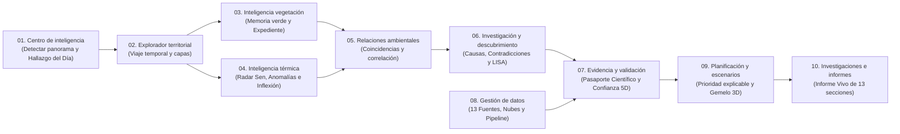

# TRAZA / MICROCLIMA — Documento Maestro de las 10 Pantallas del Laboratorio Inteligente de Microclimas Urbanos de Cochabamba

> **Propósito de este documento**: Detallar con total claridad la arquitectura funcional, visual, científica y tecnológica del **Panel Principal de 10 Pantallas**, mostrando cómo se integran **absolutamente todas las ideas, las 21 capacidades originales, las 6 funciones WOW, las 13 fuentes satelitales/municipales y las herramientas transversales** definidas en `TRAZA_ESPECIFICACION.md`, organizadas en un entorno conectado de **10 pantallas de alto impacto visual** diseñado para la **Hackatón NASA Space Apps × Alcaldía de Cochabamba (GAMC)**.

---

## 0. Filosofía del Proyecto y Consolidación en 10 Pantallas

**TRAZA** no es un visor estático de mapas de calor ni un dashboard administrativo lleno de texto. Es un **laboratorio digital de inteligencia ambiental y geoespacial** que transforma observaciones satelitales de la **NASA / ESA** y datos territoriales de la **Alcaldía de Cochabamba (GAMC)** en evidencia auditable para investigar cambios microclimáticos, contrastar hipótesis y simular escenarios urbanos.

### 0.1. Mapa Maestro de Consolidación (`21 Pantallas Originales + 6 WOW → 10 Pantallas Oficiales`)

Para lograr una navegación ágil, potente y sin fragmentación, todas las capacidades de `TRAZA_ESPECIFICACION.md` se consolidan sin perder una sola funcionalidad en **10 módulos principales** (acompañados opcionalmente por una vista ejecutiva rápida de telemetría al ingresar):

| N° | Pantalla Oficial en Navegación | Capacidades de `TRAZA_ESPECIFICACION.md` que integra | Innovaciones «Corazón de TRAZA» incluidas |
| :-: | :--- | :--- | :--- |
| **01** | **Centro de inteligencia** | **P1** (Estado ambiental de Cochabamba) + Resumen ejecutivo de monitoreo | *«El hallazgo del día»*, Radar de actividad investigativa, 6 indicadores honestos, Alertas verificables. |
| **02** | **Explorador territorial** | **P2** (Mapa multicapa de Cochabamba y 15 distritos) + **WOW 1** | *«Viaje temporal por Cochabamba»* (sin interpolar vacíos), Cortina `T1 ⇄ T2`, *Atlas de memoria ambiental*. |
| **03** | **Inteligencia de la vegetación** | **P3** (Patrimonio vegetal), **P4** (Pérdida y recuperación), **P6** (Comparador distrital verde) | *«Memoria verde»*, *«Expediente de transformación verde»*, análisis de permanencia vs. estacionalidad. |
| **04** | **Inteligencia térmica** | **P7** (Radar térmico), **P8** (Anomalías), **P9** (Puntos de inflexión) | *«Radar de cambio, no solo de calor»* (*Mann-Kendall* + *Sen*), *«Anomalía contextual»*, *«Historia de transformación»* (*ruptures*). |
| **05** | **Relaciones ambientales** | **P5** (Relación vegetación-temperatura), **P6** (Comparación distrital bivariada) | *«Detector de coincidencias ambientales»* (5 clases), Constructor X/Y multivariable, Grafo dinámico de variables. |
| **06** | **Investigación y descubrimiento** | **P10** (Posibles causas), **P11** (Descubrimientos inesperados), **P12** (Patrones espaciales) + **WOW 2 y 6** | *«Investigación guiada»*, *«¿Qué no estamos viendo?»*, *«Detector de contradicciones»*, *«Fronteras térmicas»* (*Moran / LISA / Gi\**), Grafo de conocimiento. |
| **07** | **Evidencia y validación** | **P13** (Auditor de evidencia), **P14** (Prioridad de medición), **P15** (Validación de modelos) + **WOW 3** | *«Pasaporte científico»* (6 etapas), *«No sabemos todavía»*, *«Índice de confianza territorial 5D»*, *«Dónde medir para aprender más»*, *«Historial de confianza»*. |
| **08** | **Gestión de datos** | **P20** (Centro de datos y fuentes), **P14** (Mapa de cobertura y vacíos), **P21** (Procesamiento y modelos) | *«Pasaporte de datos»*, Flujo animado de 6 etapas, Calendario de nubosidad, *«Reproducir análisis»*, Importador validado. |
| **09** | **Planificación y escenarios** | **P16** (Priorización explicable), **P17** (Laboratorio de escenarios) + **WOW 4 y 5** | *«Prioridad explicable»* multicriterio, *«Mapa de oportunidades verdes»*, *«Ciudad contrafactual»*, *«¿Qué pasaría si...?»*, *Gemelo / Vista 3D conceptual*. |
| **10** | **Investigaciones e informes** | **P19** (Centro de investigaciones y proyectos), **P18** (Generador automático de informes) | *«Una investigación nunca empieza desde cero»*, *«Informe vivo»* (13 secciones técnicas), Línea temporal + Grafo documental, Modo claro `#F5F7FC`. |

---

### 0.2. Reglas Científicas Inquebrantables en las 10 Pantallas

1. **`LST ≠ Temperatura del Aire`**: Los satélites térmicos (*Landsat TIRS, MODIS, VIIRS, ECOSTRESS*) miden **Temperatura Superficial Terrestre (LST)** (emisión radiativa de techos, asfalto, suelo y copas), nunca la temperatura ambiente del aire a 1.5–2 m medida por estaciones meteorológicas. Toda pantalla térmica muestra esta distinción de forma permanente.
2. **`NDVI ≠ Conteo Directo de Árboles`**: El índice $NDVI = \frac{NIR - Red}{NIR + Red}$ mide vigor y respuesta espectral fotosintética $[-1, +1]$. No equivale directamente a número de árboles ni a hectáreas exactas de áreas verdes públicas sin calibración adicional, ni una caída de NDVI confirma tala automáticamente (puede responder a estacionalidad, sequía o rotación agrícola).
3. **`Correlación ≠ Causalidad`**: Ninguna coincidencia espacial o coeficiente estadístico se presenta como prueba causal automática; se trata como evidencia candidata para contraste metodológico.
4. **Límites Oficiales de los 15 Distritos (GAMC)**: Los límites administrativos de los 15 distritos deben provenir exclusivamente de cartografía oficial validada del GAMC, sin trazar polígonos distritales ficticios.
5. **Transparencia de Datos y Vacíos**: No se interpolan ni ocultan períodos sin observaciones válidas (ej. nubosidad estacional de época húmeda en el Tunari) ni se inventan cifras donde aún no existe conexión a backend o sensores en campo.

---

# DETALLE PROFUNDO PANTALLA POR PANTALLA (01 A 10)

---

## PANTALLA 01. CENTRO DE INTELIGENCIA
*Punto de entrada científico al laboratorio · Integra P1 de TRAZA y la visión ejecutiva del estado ambiental de Cochabamba.*

### 1. ¿Qué tendrá?
- **Encabezado contextual discreto**: Título *"Centro de inteligencia"*, subtítulo *"Observa, investiga y comprende las transformaciones ambientales de Cochabamba"*, y cápsulas de metadatos (Territorio de estudio, Periodo disponible, Fecha de última actualización y Estado real de los datos).
- **Los 6 Indicadores Principales con trazabilidad directa**:
  1. Fuentes disponibles (públicas listas vs. locales pendientes).
  2. Periodos analizados (ventanas estacionales comparables).
  3. Investigaciones activas.
  4. Análisis completados / estado de cola.
  5. Hallazgos candidatos en revisión.
  6. Zonas con información insuficiente.
- **Mapa General Multicapa de Cochabamba** con encendido progresivo de capas (*Vegetación, Temperatura superficial LST, Cobertura urbana, Elevación NASADEM, Zonas de análisis y Hallazgos registrados*).
- **«El Hallazgo del Día»**: Tarjeta destacada que presenta la coincidencia ambiental más relevante detectada para revisión humana, con 4 acciones inmediatas (*Abrir zona en mapa, Consultar serie histórica, Evaluar calidad de datos, Iniciar investigación*).
- **Radar Circular de Actividad Investigativa**: Visualización radial/temporal de investigaciones recientes, nuevos lotes satelitales, procesamientos completados y hallazgos pendientes de auditoría.
- **Bandeja de Hallazgos Candidatos y Alertas Inteligentes**: Tarjetas visuales compactas con zona, variable, periodo, fuente, semáforo de evidencia y salto directo al módulo analítico correspondiente.

### 2. ¿Por qué existe esta pantalla?
Porque quien ingresa a un laboratorio ambiental no debe enfrentarse ni a una tabla administrativa fría ni a un mapa mudo: necesita un **centro de comando científico** que en segundos muestre qué sabemos hoy sobre Cochabamba, dónde están ocurriendo anomalías y dónde faltan observaciones.

### 3. ¿Para qué sirve? (Preguntas que responde)
- ¿Qué está sucediendo ambientalmente en el Valle de Cochabamba?
- ¿Qué fuentes y períodos válidos tenemos disponibles hoy?
- ¿Qué patrones o hallazgos candidatos requieren atención prioritaria?
- ¿Qué sectores tienen vacíos de información y qué puedo investigar a continuación?

### 4. ¿Con qué datos y tecnologías trabaja?
- **Fuentes**: Resumen de catálogo de *Sentinel-2 (10 m)*, *Landsat 8/9 (30 m)*, *NASADEM (30 m)*, *MODIS/VIIRS*, *OpenStreetMap* y estado de integración con *GAMC / Red MÓNICA*.
- **Tecnologías**: Motor geoespacial interactivo Canvas/MapLibre, gráficos vectoriales reactivos con *sparklines*, radar multivariable de 5 ejes y estado global sincronizado de zona/periodo.

### 5. ¿Qué herramientas e IA incluye?
- Conmutadores rápidos de capas sobre el mapa central.
- Ficha contextual emergente al hacer clic sobre cualquier zona del valle con salto directo a Vegetación, Térmica, Relaciones o Escenarios.
- **Asistente IA — Perfil *Orientador de Investigaciones***: Responde consultas sobre disponibilidad de datos, investigaciones pendientes, zonas con mejor cobertura y análisis recomendados.

### 6. ¿Qué se verá visualmente y cuál es su efecto WOW?
- Una **cabina de mando aeroespacial oscura** (`#111B32` / cristal translúcido) con **mínimo texto y alta densidad gráfica**: 6 tarjetas superiores con micro-curvas luminosas, un gran mapa central bioluminiscente con **barrido de radar geoespacial sutil**, el radar poligonal de actividad a la derecha y 4 tarjetas visuales de hallazgos candidatos abajo.

### 7. ¿En qué ayudará?
- Permite a autoridades municipales, investigadores y jurados tener una **lectura ejecutiva inmediata y honesta** del pulso microclimático de la ciudad y saltar en un clic hacia cualquier investigación profunda.

---

## PANTALLA 02. EXPLORADOR TERRITORIAL
*Espacio geográfico principal del laboratorio · Integra P2 de TRAZA, el «Viaje temporal por Cochabamba» y el Atlas de Memoria Ambiental (WOW 1).*

### 1. ¿Qué tendrá?
- **Lienzo Geográfico Dominante (65 % – 75 % de la pantalla)** preparado para cartografía base, relieve sombreado, áreas verdes, edificaciones, red vial, cobertura del suelo, capas ráster ambientales y límites de los **15 distritos municipales** (mostrados únicamente cuando provengan de cartografía oficial validada por GAMC).
- **Gestor de 6 Grupos de Capas Independientes**:
  1. *Térmico* (LST, tendencias, anomalías).
  2. *Vegetación* (NDVI, pérdida y recuperación).
  3. *Territorio* (uso de suelo, huella construida OSM).
  4. *Geografía* (elevación, pendiente y orientación NASADEM).
  5. *Población* (densidad WorldPop y equipamientos).
  6. *Evidencia* (cobertura válida, incertidumbre y vacíos).
- **Comparador Dividido Tipo Cortina (`T1 ⇄ T2`)**: Deslizador central interactivo con fecha anterior a la izquierda, fecha posterior a la derecha y lectura de diferencias (`Δ`).
- **«Viaje Temporal por Cochabamba» (Línea temporal inferior)**: Reproductor histórico por períodos que **marca explícitamente los vacíos nubosos (`⊘ VACÍO NUBES`) sin interpolar ni inventar imágenes intermedias**.
- **Panel Contextual Derecho con Gráficos Sincronizados**: Perfil topográfico Norte-Sur (Cordillera del Tunari → Río Rocha → Centro → Laguna Alalay → Itocta), dona de composición del suelo, barras espectrales multibanda (`B2` a `TIRS`) y miniatura satelital.

### 2. ¿Por qué existe esta pantalla?
Porque los fenómenos microclimáticos de Cochabamba dependen profundamente de la **geografía del valle** (altitud del Tunari, corredor del Río Rocha, cubeta lacustre de Alalay y densificación del centro/sur). Se requiere un estudio espacial multicapa donde las variables puedan superponerse con rigor cartográfico.

### 3. ¿Para qué sirve? (Preguntas que responde)
- ¿Dónde se localiza exactamente un fenómeno térmico o vegetal?
- ¿Qué variables físicas, urbanas y poblacionales se superponen en un mismo sector?
- ¿Cómo cambió visualmente un barrio entre dos años comparables?
- ¿Qué calidad y resolución de datos existe en cada punto del mapa?

### 4. ¿Con qué datos y tecnologías trabaja?
- **Fuentes**: *Sentinel-2 L2A (10 m)*, *Landsat 8/9 OLI/TIRS (30 m)*, *NASADEM (30 m)*, *OpenStreetMap (vectorial)*, *WorldPop (100 m)* y conector para *GeoJSON oficial de 15 distritos GAMC*.
- **Tecnologías**: Visor geoespacial preparado para *MapLibre GL JS / HTML5 Multi-Spectral Canvas*, superposición vectorial orgánica, recorte por cortina CSS/SVG y modo de pantalla completa.

### 5. ¿Qué herramientas e IA incluye?
- Control de encendido/apagado, **opacidad gradual (0–100 %)**, consulta de fuente/resolución y leyenda dinámica.
- **Herramientas espaciales**: Selección por punto, selección/dibujo de polígono, medición de distancia y gradiente (`km` y `Δ°C`), consulta de coordenadas, zoom progresivo, pantalla completa (`⛶`) y botón **`★ Guardar zona de interés`**.
- **Asistente IA — Perfil *Asistente Geoespacial Contextual***: Recibe automáticamente el ID de la zona activa, las capas encendidas y el periodo temporal para sugerir cruces de capas y advertir vacíos locales.

### 6. ¿Qué se verá visualmente y cuál es su efecto WOW?
- Un **estudio geoespacial cinematográfico**: al seleccionar una unidad territorial se enciende un **contorno luminoso celeste (`#65C8F2`)**, se atenúa suavemente el entorno, la cortina `T1 ⇄ T2` revela la transformación urbana al arrastrar el cursor y abajo corre la curva del transecto altitudinal junto con la cinta de ventanas válidas vs. vacíos estacionales.

### 7. ¿En qué ayudará?
- Permite inspeccionar Cochabamba desde escala metropolitana hasta escala de corredor o manzana, evitando errores habituales como confundir enfriamiento por altitud (Tunari) con enfriamiento por vegetación urbana.

---

## PANTALLA 03. INTELIGENCIA DE LA VEGETACIÓN
*«El verde también cuenta la historia de una ciudad» · Integra P3 (Huella Verde), P4 (Pérdida y recuperación) y P6 (Comparación distrital vegetal).*

### 1. ¿Qué tendrá?
Organizada visualmente mediante **3 sub-vistas interactivas** para evitar cualquier sobrecarga de texto:
- **Sub-vista A — Huella Verde y «Memoria Verde»**:
  - Mapa histórico de actividad fotosintética NDVI con escala semántica oficial (`#D9F0DC` → `#8BCB9A` → `#43A875` → `#237B5B`).
  - Anillo radial de distribución por estratos de NDVI (*Vigor alto `>0.60`*, *Parque/ripario `0.40–0.60`*, *Vegetación rala `0.20–0.40`*, *Suelo/impermeable `<0.20`*).
  - Línea temporal **«Memoria Verde»** para reconstruir procesos graduales, caídas abruptas o recuperaciones posteriores.
- **Sub-vista B — Detector de Pérdida y Recuperación Vegetal**:
  - Clasificación espacial y porcentual en 4 categorías: *Posible disminución*, *Posible incremento / recuperación*, *Comportamiento estable* y *Cambio no concluyente (baja calidad QA)*.
  - Cortina deslizante Antes/Después sobre el mapa NDVI y gráfico de barras divergentes (`+ΔNDVI` vs. `−ΔNDVI`) comparando todas las macro-zonas / distritos.
- **Sub-vista C — «Expediente de Transformación Verde» y Análisis de Permanencia**:
  - Galería comparativa de 3 parches satelitales (`T1 Anterior`, `T2 Posterior`, `Δ Diferencia Espectral`) con sensor, fecha y `% de píxeles válidos`.
  - Ecualizador multitemporal de **permanencia** para distinguir una fluctuación estacional, sequía o cosecha agrícola de una **transformación urbana persistente**.

### 2. ¿Por qué existe esta pantalla?
Porque en ciudades andinas semiáridas como Cochabamba la vegetación cambia drásticamente entre estación lluviosa y estación seca. Comparar dos fotos al azar produce falsas alarmas; se necesita inteligencia temporal que compare **ventanas estacionales equivalentes** y evalúe persistencia.

### 3. ¿Para qué sirve? (Preguntas que responde)
- ¿Cómo evoluciona el vigor vegetal en los corredores, parques y zonas de expansión de Cochabamba?
- ¿Dónde existen pérdidas vegetales persistentes frente a simples variaciones estacionales?
- ¿Qué sectores muestran señales reales de recuperación o revegetación urbana?

### 4. ¿Con qué datos y tecnologías trabaja?
- **Fuentes**: *Copernicus Sentinel-2A/2B MSI (10 m, bandas B4 Rojo y B8 NIR + máscara SCL)* y *Landsat 8/9 OLI (30 m, máscara QA_PIXEL)* para series largas.
- **Métodos**: Cálculo normalizado de NDVI, filtrado estricto de nubes/sombras, diferencias interanuales en época seca comparable y clasificación de persistencia multitemporal.

### 5. ¿Qué herramientas e IA incluye?
- Selector de sub-vista (*Memoria Verde / Cambios / Expediente*), cortina `T1 ⇄ T2`, filtro por periodo estacional y advertencia metodológica permanente **`NDVI ≠ conteo de árboles ni superficie exacta de copas`**.
- **Asistente IA — Perfil *Especialista en Índices y Cambios Vegetales***: Explica variaciones de NDVI, propone hipótesis alternativas (estacionalidad, humedad, agricultura periurbana vs. urbanización) y recomienda ventanas comparables.

### 6. ¿Qué se verá visualmente y cuál es su efecto WOW?
- Un **mapa bioluminiscente de clorofila** donde los corredores como el Río Rocha y el pie de monte del Tunari brillan en tonos esmeralda mientras las zonas fragmentadas resaltan al instante, acompañado por el anillo espectral, curvas fenológicas suaves y el **Expediente visual Antes / Después / Δ**.

### 7. ¿En qué ayudará?
- Protege el patrimonio arbóreo y ripario de Cochabamba identificando con rigor dónde se está fragmentando la conectividad ecológica y dónde las intervenciones verdes están logrando recuperarse.

---

## PANTALLA 04. INTELIGENCIA TÉRMICA
*«El calor también deja patrones» · Integra P7 (Radar de transformaciones térmicas), P8 (Anomalías contextuales) y P9 (Puntos de inflexión).*

### 1. ¿Qué tendrá?
Con la regla **`LST Superficial (°C) ≠ Temperatura del Aire`** visible en todo momento, integra **3 sub-laboratorios visuales**:
- **Sub-vista A — «Radar de Cambio, No Solo de Calor» (Tendencias)**:
  - Mapa térmico histórico LST (`#FFF0B3` → `#FFCB73` → `#F28B50` → `#D95757` → `#963D63`) + **Mapa Iso-Térmico por contornos horarios** (`06H, 10H, 14H, 18H, 22H`).
  - Estimación no paramétrica mediante **Test de Mann-Kendall** (dirección/significancia) y **Pendiente de Theil-Sen** ($\Delta^\circ\text{C}/\text{año}$).
  - Clasificación en las **5 categorías térmicas de TRAZA**:
    1. *Caliente y con tendencia creciente* (ej. núcleos densos impermeables).
    2. *Caliente sin tendencia creciente demostrada*.
    3. *Tendencia creciente rápida aunque aún no sea la más caliente hoy* (alerta temprana en zonas de expansión como Itocta).
    4. *Sin tendencia concluyente*.
    5. *Evidencia insuficiente*.
- **Sub-vista B — Detector de «Anomalía Contextual»**:
  - Osciloscopio que contrasta la LST observada de una zona frente a **su propia línea base histórica estacional** y su entorno altitudinal.
  - Clasificación temporal de anomalías en *Puntual*, *Repetida* o *Persistente*, más histograma radiométrico de píxeles críticos.
- **Sub-vista C — Detector de Puntos de Inflexión («Historia de Transformación»)**:
  - Serie histórica con detección estadística de quiebres estructurales (*algoritmos tipo `ruptures`*), comparando **promedio, pendiente y variabilidad Antes vs. Después del año de ruptura** (ej. aceleración urbana post-2022).

### 2. ¿Por qué existe esta pantalla?
Porque mirar únicamente qué lugar es caliente hoy oculta el dato más estratégico para planificar una ciudad: **qué barrios se están calentando más rápido** y **en qué año exacto cambió su régimen térmico**.

### 3. ¿Para qué sirve? (Preguntas que responde)
- ¿Cómo se distribuyen las islas de calor superficiales diurnas y nocturnas en Cochabamba?
- ¿Qué sectores presentan calentamiento sostenido estadísticamente significativo?
- ¿Una temperatura alta es normal para esa zona y época o es una anomalía persistente?
- ¿Cuándo ocurrió un punto de quiebre térmico en un sector en transformación?

### 4. ¿Con qué datos y tecnologías trabaja?
- **Fuentes**: *Landsat 8/9 TIRS Level-2 LST (100 m remuestreado a 30 m)*, *MODIS Terra/Aqua (1 km diurno/nocturno)*, *VIIRS (375 m/750 m nocturno)*, *ISS ECOSTRESS (70 m según disponibilidad de órbita)* y *ERA5-Land / Open-Meteo* para contexto atmosférico.
- **Nota técnica explícita**: El sistema distingue las resoluciones espaciales y frecuencias de cada sensor y **no simula transmisión térmica en vivo** cuando se visualizan escenas satelitales históricas.

### 5. ¿Qué herramientas e IA incluye?
- Selector horario de contornos iso-térmicos, conmutador entre *Radar de Cambio / Anomalías / Puntos de Inflexión*, reproductor multianual y comparación directa frente a refugios frescos (Río Rocha / Tunari).
- **Asistente IA — Perfil *Especialista en Análisis Térmico Superficial***: Explica diferencias entre LST y aire, interpreta pendientes de Sen y p-valores de Mann-Kendall, y sugiere variables de emisividad/albedo para explicar focos cálidos.

### 6. ¿Qué se verá visualmente y cuál es su efecto WOW?
- Un **radar termográfico infrarrojo de pantalla ancha** combinado con el **mapa de contornos iso-térmicos interactivo** que cambia suavemente según la franja horaria, curvas duales Día/Noche con etiquetas flotantes tipo osciloscopio y tarjetas comparativas Pre/Post punto de inflexión.

### 7. ¿En qué ayudará?
- Permite detectar **islas de calor crónicas y frentes emergentes de calentamiento** antes de que se consoliden, orientando enfriamiento urbano basado en evidencia radiométrica.

---

## PANTALLA 05. RELACIONES AMBIENTALES
*Laboratorio estadístico bivariado y multivariable · Integra P5 (Analizador vegetación-temperatura) y comparación inter-distrital.*

### 1. ¿Qué tendrá?
- **Constructor Visual de Análisis**: Selección interactiva de **Variable X**, **Variable Y**, área/zona, periodo y **Método Estadístico** (*Pearson*, *Spearman no paramétrico* y *Correlación parcial controlando elevación DEM*), preparado para 9 variables (*NDVI, LST, Elevación, Cobertura del suelo, Edificaciones, Densidad edificada, Distancia a áreas verdes, Clima ERA5 y Densidad poblacional WorldPop*).
- **«Detector de Coincidencias Ambientales» (Las 5 clases bivariadas de TRAZA)**:
  1. `↓ Vegetación + ↑ Temperatura superficial` *(Coincidencia crítica prioritaria)*.
  2. `↑ Vegetación + ↓ Temperatura superficial` *(Amortiguación bioclimática favorable)*.
  3. `= Vegetación + ↑ Temperatura superficial` *(Contradicción → investigar techos, materiales o pendiente)*.
  4. `↓ Vegetación + = Temperatura superficial` *(Sin respuesta térmica aparente en el periodo)*.
  5. `Datos insuficientes` *(No evaluable con confianza)*.
- **Diagrama de Dispersión Satelital Sincronizado (*Scatter Plot*)**: Nube de píxeles muestreados + centroides interactivos de las zonas del valle + curva de tendencia no paramétrica.
- **Matriz de Correlación Multivariable `5 × 5`** codificada por color e intensidad (`+` cálido / `−` celeste).

### 2. ¿Por qué existe esta pantalla?
Porque superponer dos mapas a simple vista engaña al ojo humano. Se necesita un **laboratorio estadístico interactivo** que cuantifique la fuerza, dirección y variación espacial de las relaciones ambientales controlando factores de confusión como la altitud.

### 3. ¿Para qué sirve? (Preguntas que responde)
- ¿Qué tan fuerte es la relación inversa entre vigor vegetal (NDVI) y temperatura superficial (LST) en Cochabamba?
- ¿Cuánto influyen el sellado urbano (asfalto/edificaciones) y la elevación topográfica frente a la vegetación?
- ¿En qué sectores se cumple la amortiguación vegetal y en cuáles aparecen excepciones que exigen nueva investigación?

### 4. ¿Con qué datos y tecnologías trabaja?
- **Fuentes**: Cruce espacial co-registrado de *Sentinel-2 (NDVI)*, *Landsat 8/9 (LST)*, *NASADEM (Elevación/Pendiente)*, *OpenStreetMap (Densidad construida)* y *WorldPop (Población)*.
- **Métodos**: Correlación lineal de Pearson, correlación por rangos de Spearman (robusta ante valores extremos), correlaciones parciales y regresión exploratoria (*SciPy / Statsmodels*).

### 5. ¿Qué herramientas e IA incluye?
- Píldoras para cambiar al instante los ejes `X × Y` y el estimador estadístico, sincronización bidireccional (hacer clic en un clúster del gráfico de dispersión selecciona la zona en toda la plataforma) y sello fijo **`Correlación ≠ Causalidad`**.
- **Asistente IA — Perfil *Asistente Estadístico y Multivariable***: Recomienda cuándo usar Spearman frente a Pearson, sugiere variables de control y evita interpretaciones causales apresuradas.

### 6. ¿Qué se verá visualmente y cuál es su efecto WOW?
- Cinco tarjetas luminosas superiores con las **coincidencias ambientales**, a la izquierda una **nube de dispersión estelar sobre fondo oscuro** con centroides brillantes por zona y curva punteada celeste, y a la derecha el **mosaico térmico-celeste `5 × 5`** de acoplamiento multivariable.

### 7. ¿En qué ayudará?
- Demuestra con números y gráficos claros cuánto amortiguan térmicamente los corredores verdes como el Río Rocha frente a las áreas pavimentadas, respaldando políticas urbanas con estadística robusta.

---

## PANTALLA 06. INVESTIGACIÓN Y DESCUBRIMIENTO
*Motor científico de hipótesis, contradicciones y patrones espaciales · Integra P10, P11, P12 y los WOW 2 y 6.*

### 1. ¿Qué tendrá?
Organizada en **3 modos visuales de descubrimiento**:
- **Modo 1 — Grafo de Conocimiento Ambiental (E) e Investigador de Posibles Causas (A)**:
  - **Grafo interactivo documentado** que conecta con significado explícito: `Fuentes → Periodo → Zona → Hallazgo → Hipótesis → Investigación`.
  - **Panel visual de contraste de causas** en 3 columnas para el hallazgo seleccionado: *Evidencia a favor*, *Evidencia en contra / explicaciones alternativas* (ej. techos de calamina, rotación agrícola) y *Variables faltantes*.
- **Modo 2 — Motor de Descubrimientos (B), Contradicciones (WOW 2) y «Preguntas que vale la pena investigar» (WOW 6)**:
  - Detección de comportamientos contra-intuitivos (ej. zonas donde la temperatura superficial sube pese a tener NDVI estable).
  - Sección **«Preguntas que vale la pena investigar» (*¿Qué no estamos viendo?*)**, claramente separada de los hallazgos confirmados y etiquetada con estados de flujo científico (*Nuevo, En revisión, Verificado, Descartado*).
- **Modo 3 — Patrones entre Zonas / «Fronteras Térmicas» (C) y Constructor de Hipótesis (D)**:
  - Estadística espacial (*Moran's I global*, *LISA local* y *Getis-Ord Gi\**) clasificando agrupamientos significativos: **Clúster cálido (`Alto–Alto`)**, **Refugio fresco (`Bajo–Bajo`)**, **Zonas de transición / fronteras térmicas (`Alto–Bajo` / `Bajo–Alto`)**.
  - **Constructor interactivo de hipótesis** para registrar pregunta, hipótesis contrastable, método propuesto y evidencia requerida.

### 2. ¿Por qué existe esta pantalla?
Porque la verdadera innovación científica no consiste solo en responder lo que ya sabemos preguntar, sino en **descubrir anomalías multivariables, fronteras ocultas entre barrios y contradicciones** que abren nuevas líneas de investigación para Cochabamba.

### 3. ¿Para qué sirve? (Preguntas que responde)
- ¿Qué factores rivales podrían explicar una anomalía antes de sacar conclusiones?
- ¿Dónde se agrupan estadísticamente las islas de calor y dónde están las fronteras bruscas de transición térmica?
- ¿Qué preguntas científicas nuevas emergen de las contradicciones en los datos?

### 4. ¿Con qué datos y tecnologías trabaja?
- **Fuentes**: Cubo multitemporal integrado (*Sentinel-2 + Landsat + NASADEM + OSM*) y catálogo de hallazgos candidatos.
- **Métodos**: Autocorrelación espacial global y local (*PySAL: Moran, LISA, Gi\**), grafos de trazabilidad relacional y razonamiento estructurado por hipótesis.

### 5. ¿Qué herramientas e IA incluye?
- Selector de hallazgo conectado al grafo, filtro de clústeres LISA sincronizado con el mapa, formulario rápido de registro de hipótesis y etiquetas de estado de revisión.
- **Asistente IA — Perfil *Asistente de Hipótesis y Descubrimiento***: Responde siempre bajo la estructura científica de 5 bloques (**Lo que se observa**, **Posibles explicaciones**, **Evidencia disponible**, **Evidencia faltante** y **Análisis recomendado**).

### 6. ¿Qué se verá visualmente y cuál es su efecto WOW?
- Un **espacio neuronal de descubrimiento**: mapa de clústeres espaciales a la izquierda y a la derecha el **grafo luminoso de nodos interconectados** que al seleccionar un hallazgo despliega sus fuentes, contradicciones e hipótesis vinculadas.

### 7. ¿En qué ayudará?
- Eleva el proyecto al nivel de un verdadero **laboratorio de investigación científica para universidades, NASA y equipos técnicos municipales**, evitando sesgos de confirmación.

---

## PANTALLA 07. EVIDENCIA Y VALIDACIÓN
*Centro de confianza, auditoría y reproducibilidad científica · Integra P13, P14, P15 y el Índice de Confianza Territorial (WOW 3).*

### 1. ¿Qué tendrá?
- **WOW — «Pasaporte Científico» Visual en 6 Eslabones Conectados (A y E)**:
  - Recorrido completo y auditable para cada resultado: `01 Fuente` → `02 Procesamiento QA` → `03 Método y Parámetros` → `04 Resultado` → `05 Estado de Validación` → `06 Limitaciones`, con ID único compartible (`TRAZA-EV-...`).
  - **Semáforo transparente de evidencia**: *Alta (`#43A875`)*, *Moderada (`#E6B85C`)* e *Insuficiente / **«No sabemos todavía»** (`#D95757`)*.
- **WOW 3 — «Índice de Confianza Territorial» Multidimensional (B)**:
  - **Radar de 5 ejes independientes** (*Cobertura espacial, Completitud temporal, Calidad radiométrica, Validación en campo y Consistencia entre periodos*), evitando ocultar las limitaciones detrás de un único número opaco.
- **Mapa de Incertidumbre y «Dónde medir para aprender más» (P14)**:
  - Mapa que cruza vacíos ópticos e islas térmicas para recomendar **dónde instalar nuevos sensores terrestres o campañas de campo** para reducir al máximo la incertidumbre (manteniendo separada la temperatura del aire terrestre de la LST satelital).
- **Validación de Modelos e «Historial de Confianza» (C y D)**:
  - Panel de evaluación frente a referencia independiente con soporte para variables continuas (**`MAE`**, **`RMSE`**, **`R²`**, **`Sesgo`**) y clasificación de cambios (**`Precision`**, **`Recall`**, **`F1-score`** y **Matriz de Confusión `3 × 3`**), además de comparación entre versiones (`v0.1` vs. `v0.2`).

### 2. ¿Por qué existe esta pantalla?
Porque en ciencia ambiental **un gráfico atractivo sin control de calidad ni incertidumbre declarada puede inducir a malas decisiones públicas**. Esta pantalla convierte la honestidad científica —incluido decir *«No sabemos todavía»*— en una ventaja competitiva del proyecto.

### 3. ¿Para qué sirve? (Preguntas que responde)
- ¿De qué satélite, resolución, máscara de nubes y fórmula exacta proviene este hallazgo?
- ¿Qué nivel de certeza e incertidumbre tiene cada zona del mapa?
- ¿Dónde debería invertir la Alcaldía o la universidad en instalar sensores terrestres para validar mejor el valle?
- ¿Cómo mejoró o cambió un modelo entre su versión anterior y la actual?

### 4. ¿Con qué datos y tecnologías trabaja?
- **Fuentes**: Bandas de control de calidad `QA_PIXEL` (*Landsat*), `SCL` (*Sentinel-2*), metadatos de versión de algoritmo y contratos de calibración con estaciones terrestres (*Red MÓNICA / SENAMHI / campañas in-situ*).
- **Métodos**: Métricas geofísicas estándar CEOS/NASA (`MAE, RMSE, R², F1`), separación estricta entrenamiento/validación espacial-temporal y registro reproducible de parámetros.

### 5. ¿Qué herramientas e IA incluye?
- Conmutador entre *Confianza 5D & Vacíos* y *Validación de Modelos (MAE/RMSE/Matriz de Confusión)*, inspección interactiva del Pasaporte Científico y mapa priorizado de sitios de medición.
- **Asistente IA — Perfil *Auditor Científico de Evidencia***: Explica por qué un resultado tiene evidencia moderada o limitada, detalla qué validación en campo falta y evalúa si dos períodos son metodológicamente comparables.

### 6. ¿Qué se verá visualmente y cuál es su efecto WOW?
- En la parte superior brilla la **cadena de 6 nodos del Pasaporte Científico** con barras de progreso QA; abajo, el mapa de brechas junto al **radar pentagonal de confianza territorial** y la **matriz de confusión visual `3 × 3`**.

### 7. ¿En qué ayudará?
- Brinda **credibilidad científica total ante jurados de la NASA y autoridades técnicas**, garantizando que cada resultado pueda defenderse, auditarse y reproducirse.

---

## PANTALLA 08. GESTIÓN DE DATOS
*Centro de administración de las 13 fuentes, calendario de nubosidad y pipelines · Integra P20, P14 (cobertura/vacíos) y P21 (procesamiento, modelos y «Reproducir análisis»).*

### 1. ¿Qué tendrá?
- **WOW — Flujo Visual de Datos en 6 Etapas**:
  - Visualización estructurada del pipeline: `1. Fuente` → `2. Adquisición (GEE / STAC)` → `3. Control de Calidad QA` → `4. Procesamiento (UTM 19S)` → `5. Almacenamiento Raster/PostGIS` → `6. Análisis Científico`, reflejando estados reales (catálogo listo vs. cola en espera, sin simular actividad falsa).
- **Catálogo Auditado de las 12–13 Fuentes Previstas (`Pasaporte de Datos`)**:
  - *Landsat 8/9*, *Sentinel-2*, *MODIS*, *VIIRS*, *ISS ECOSTRESS*, *ERA5-Land*, *Open-Meteo*, *NASADEM*, *OpenStreetMap*, *WorldPop*, *Cartografía Oficial GAMC (15 distritos)*, *Mediciones Terrestres* y *Red MÓNICA*.
  - Cada tarjeta muestra institución, resolución nativa, frecuencia de revisita, cobertura, licencia y estado real de conexión.
- **Calendario Estacional de Nubosidad y Disponibilidad (`12 Meses × Sensores`)**:
  - Matriz térmica anual (`ENE` a `DIC`) que hace evidente de un vistazo por qué mayo–octubre ofrece `90–98 %` de escenas limpias mientras enero–marzo presenta vacíos críticos por nubosidad lluviosa.
- **Monitor de Procesamiento, Catálogo de Algoritmos («Reproducir Análisis») e Importador Validado**:
  - Estado de algoritmos configurados (*Theil-Sen/Mann-Kendall, Moran/LISA, Ruptures, Recorte GAMC*).
  - Herramienta de **importación local** para `GeoJSON`, `Shapefile (.zip)`, `GeoTIFF`, `CSV` y `NetCDF` con validación previa de formato, CRS (`WGS84 / UTM Zona 19S`) y metadatos.

### 2. ¿Por qué existe esta pantalla?
Porque un laboratorio multi-satelital que fusiona datos orbitales de la NASA/ESA con capas locales de la Alcaldía necesita un **centro transparente de gobierno de datos** donde se audite qué está conectado, qué resolución tiene cada fuente y cuándo hay nubes.

### 3. ¿Para qué sirve? (Preguntas que responde)
- ¿Qué fuentes satelitales, climáticas y municipales integran la plataforma y en qué estado están?
- ¿Qué meses del año son óptimos para comparar imágenes ópticas sin sesgo de nubes en Cochabamba?
- ¿Cómo subir una capa nueva de la Alcaldía o de una tesis universitaria validando su proyección geográfica?

### 4. ¿Con qué datos y tecnologías trabaja?
- **Tecnologías previstas de arquitectura**: *Google Earth Engine (GEE)* / catálogos *STAC Cloud-Optimized GeoTIFF (COG)*, *FastAPI*, *PostgreSQL + PostGIS*, *Rasterio*, *Xarray*, *GeoPandas* y validación de esquemas en cliente.

### 5. ¿Qué herramientas e IA incluye?
- Conmutador entre *Calendario de Nubosidad* y *Cola de Algoritmos*, importador interactivo de archivos geoespaciales con notificación de validación CRS y tarjetas de estado por sensor.
- **Asistente IA — Perfil *Especialista en Fuentes y Procesamiento Geoespacial***: Orienta sobre compatibilidad de resoluciones (10 m vs. 30 m vs. 1 km), formatos raster/vectoriales y requisitos para integrar capas municipales GAMC.

### 6. ¿Qué se verá visualmente y cuál es su efecto WOW?
- La **cadena horizontal de 6 nodos del pipeline orbital**, debajo el **mapa de calor calendario de 12 meses** (esmeralda en estación seca, coral en meses nubosos de verano) y la cuadrícula de **tarjetas de telemetría de cada satélite/fuente** con barras de cobertura.

### 7. ¿En qué ayudará?
- Facilita la escalabilidad técnica con la Alcaldía de Cochabamba (GAMC), dejando listos los conectores e importadores para enchufar nuevos catastros, límites distritales y estaciones de la Red MÓNICA sin rediseñar la plataforma.

---

## PANTALLA 09. PLANIFICACIÓN Y ESCENARIOS
*«¿Qué pasaría si transformamos una zona?» · Puente entre ciencia y acción urbana · Integra P16, P17, Mapa de Oportunidades Verdes (WOW 4) y Gemelo / Vista 3D Conceptual (WOW 5).*

### 1. ¿Qué tendrá?
Dividida en **2 laboratorios interactivos de alto impacto visual**:
- **Modo 1 — Laboratorio de Escenarios, «Ciudad Contrafactual» y Gemelo 3D Conceptual (B, C, D, E)**:
  - **Constructor interactivo con controles deslizantes**: *Arbolado y corredores verdes (`%`)*, *Techos reflectantes de alto albedo / techos verdes (`%`)* y *Superficie intervenida (`ha`)*.
  - **Mapa territorial con polígonos de intervención y cortina Antes/Después** sincronizado con la zona elegida.
  - **WOW 5 — Manzana Isométrica 3D Conceptual Interactiva**: Visor 3D vectorial (explícitamente etiquetado como **`REPRESENTACIÓN 3D CONCEPTUAL`**) donde al mover los *sliders* crecen árboles en el corredor, los techos cambian de absorbentes a reflectantes y el halo térmico superior se atenúa visualmente, acompañado de un radar 5D Antes vs. Simulado.
  - **Comparador de 4 Alternativas Lado a Lado**: *0. Referencia Actual*, *Escenario A (Corredor Verde)*, *Escenario B (Techos Albedo)* y *Escenario Combinado*, comparando superficie intervenida, beneficio multicriterio, datos requeridos e incertidumbre **sin inventar reducciones exactas en °C no calibradas**.
- **Modo 2 — Sistema de «Priorización Territorial Explicable» Multicriterio (A y WOW 4)**:
  - Constructor de pesos interactivos ($w_1 \dots w_4$) para *Exposición térmica*, *Déficit de vegetación*, *Exposición poblacional* y *Necesidad de medición / vacíos*, mostrando en pantalla la **fórmula normalizada exacta** y actualizando en vivo el ranking territorial.

### 2. ¿Por qué existe esta pantalla?
Porque diagnosticar islas de calor no basta: los planificadores urbanos y la Alcaldía necesitan **explorar alternativas de mitigación** y justificar de forma transparente y auditable por qué priorizar la inversión pública en un barrio o corredor específico.

### 3. ¿Para qué sirve? (Preguntas que responde)
- ¿Qué sectores de Cochabamba deben priorizarse si ponderamos exposición térmica, déficit arbóreo y densidad poblacional?
- ¿Cómo cambian conceptualmente los indicadores territoriales al combinar corredores verdes con techos fríos?
- ¿Qué mediciones locales hacen falta para pasar de una simulación multicriterio a un modelo microclimático calibrado?

### 4. ¿Con qué datos y tecnologías trabaja?
- **Fuentes**: Índices normalizados de *LST (Landsat)*, *Déficit NDVI (Sentinel-2)*, *Huella impermeable y vías (OSM)*, *Población expuesta (WorldPop)* y *Cobertura QA*.
- **Métodos**: Evaluación Multicriterio Explicable (EMC) con suma lineal ponderada normalizada y simulación contrafactual por parámetros de superficie.

### 5. ¿Qué herramientas e IA incluye?
- Sliders interactivos en tiempo real para intervenciones y ponderaciones, visor 3D conceptual reactivo, cortina espacial `T1 ⇄ T2` y comparador de 4 escenarios.
- **Asistente IA — Perfil *Asistente de Escenarios Urbanos***: Ayuda a comparar Escenario A vs. B, redacta justificaciones técnicas para proyectos verdes y advierte con transparencia los límites de simulación sin suplantar la decisión municipal.

### 6. ¿Qué se verá visualmente y cuál es su efecto WOW?
- Uno de los momentos **más espectaculares para la demostración en vivo de la hackatón**: al deslizar los controles de arborización y albedo, el jurado ve transformarse simultáneamente **el radar 5D, el mapa de parcelas, la manzana isométrica 3D conceptual y las 4 tarjetas comparativas de escenarios**.

### 7. ¿En qué ayudará?
- Convierte datos espaciales de la NASA en una **herramienta práctica de diseño urbano y adaptación climática para la Alcaldía de Cochabamba**, conectando ciencia satelital con corredores verdes, arbolado y techos fríos.

---

## PANTALLA 10. INVESTIGACIONES E INFORMES
*Espacio de continuidad científica, trazabilidad documental e «Informe Vivo» · Integra P19 y P18 de TRAZA.*

### 1. ¿Qué tendrá?
- **Centro de Investigaciones Colaborativas («Una investigación nunca empieza desde cero» — A, B, E)**:
  - Selector de expedientes científicos activos (ej. *EXP-01 Amortiguación Río Rocha*, *EXP-02 Expansión Sur Itocta*, *EXP-03 Vacíos Ópticos Tunari*), conservando pregunta científica, hipótesis, área, periodo, fuentes y análisis asociados.
- **WOW — Línea Temporal Visual de Trazabilidad Científica (F)**:
  - Recorrido conectado en 6 pasos: `1. Pregunta` → `2. Hipótesis` → `3. Fuentes` → `4. Análisis` → `5. Evidencia QA` → `6. Informe Vivo`, mostrando cómo cada conclusión nace de evidencia auditable.
- **Biblioteca de Hallazgos Vinculados (C)**:
  - Tarjetas de hallazgos guardados desde los otros 9 módulos con **salto directo en un clic de regreso al módulo y zona donde se originaron**.
- **Generador de «Informe Vivo» en Tiempo Real con las 13 Secciones Oficiales (D)**:
  - Estructura completa verificada: *01. Título, 02. Resumen, 03. Objetivo, 04. Área de estudio, 05. Fuentes, 06. Metodología, 07. Resultados, 08. Mapas, 09. Gráficos, 10. Discusión, 11. Limitaciones, 12. Conclusiones y 13. Referencias*.
  - **Póster / Vista Previa Infográfica en Tiempo Real** con mapa iso-térmico, anillo de composición espectral, curva multianual y sellos metodológicos obligatorios (`LST ≠ Aire`, `NDVI ≠ N° Árboles`, `Correlación ≠ Causalidad`).
  - **Interruptor de Modo Claro Documental Oficial (`#F5F7FC` / `#111B32`)** para lectura e impresión limpia, además de exportación de paquete reproducible JSON e impresión PDF.

### 2. ¿Por qué existe esta pantalla?
Porque en la mayoría de plataformas los análisis mueren como capturas aisladas de pantalla. Esta pantalla garantiza que todo descubrimiento del laboratorio se convierta en **documentación científica viva, versionada y lista para presentarse ante autoridades, universidades o publicaciones**.

### 3. ¿Para qué sirve? (Preguntas que responde)
- ¿Cómo organizar una investigación completa desde la pregunta inicial hasta las limitaciones y conclusiones?
- ¿Cómo generar un informe técnico o ejecutivo reproducible para un distrito o corredor de Cochabamba sin omitir advertencias metodológicas?
- ¿Cómo retomar o actualizar un estudio previo cuando ingresan nuevas imágenes satelitales?

### 4. ¿Con qué datos y tecnologías trabaja?
- **Fuentes**: Metadatos consolidados de zonas, hallazgos auditados, pasaportes de evidencia, gráficos vectoriales del estudio activo y configuración reproducible en JSON/PDF.

### 5. ¿Qué herramientas e IA incluye?
- Conmutador de expedientes, **toggle Modo HUD Oscuro (`#111B32`) ↔ Modo Claro Documental (`#F5F7FC`)**, exportación reproducible JSON, salida lista para PDF/impresión y re-apertura de hallazgos en su módulo de origen.
- **Asistente IA — Perfil *Asistente de Documentación Científica***: Ayuda a estructurar objetivos y metodología, redacta resúmenes fieles a los hallazgos vinculados y recuerda incluir limitaciones obligatorias sin inventar citas bibliográficas.

### 6. ¿Qué se verá visualmente y cuál es su efecto WOW?
- Un **estudio editorial e infográfico en vivo**: arriba la cadena de 6 hitos desde la pregunta hasta el informe, y al centro un **dossier visual ejecutivo con mapas, anillos y curvas** que con un clic pasa de cabina espacial oscura a **documento científico blanco nube (`#F5F7FC`)** listo para entregar o imprimir.

### 7. ¿En qué ayudará?
- Permite entregar a la Alcaldía de Cochabamba, concejos distritales, investigadores y ciudadanía **reportes técnicos transparentes, comprensibles y 100 % trazables**.

---

## RESUMEN DE CONEXIÓN TRANSVERSAL ENTRE LAS 10 PANTALLAS

### Herramientas Transversales que unen las 10 Pantallas en un solo Laboratorio:
1. **Contexto Territorial Compartido**: Seleccionar *Corredor Río Rocha*, *Centro / La Cancha*, *Tunari Norte*, *Laguna Alalay* o *Expansión Sur · Itocta* en cualquier pantalla mantiene esa zona sincronizada al navegar por las otras nueve.
2. **Ciclo Científico Conectado**: Barra rápida `1. Detectar → 2. Investigar → 3. Contrastar → 4. Verificar → 5. Simular → 6. Documentar`.
3. **Sistema de IA Contextual con 10 Especialistas**: Un mismo panel desplegable que cambia automáticamente de rol, preguntas sugeridas y criterios metodológicos según la pantalla activa.
4. **Buscador Global Inteligente**: Localiza módulos, zonas, fuentes satelitales y hallazgos candidatos desde cualquier lugar.
5. **Comparador Universal**: Contrasta dos zonas, períodos o escenarios manteniendo las mismas unidades y escalas.
6. **Glosario Científico Contextual**: Fórmulas, unidades y fuentes (*LST, NDVI, Theil-Sen, Mann-Kendall, Moran's I, LISA, MAE, RMSE*) a un clic.
7. **Favoritos / Espacios Guardados (`★`) y Notificaciones Verificables**: Continuidad inmediata del trabajo investigativo.

